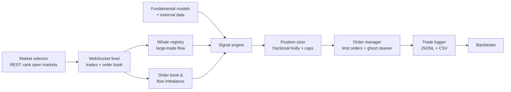

# Kalshi Prediction-Market Trading System

An asynchronous Python trading system for [Kalshi](https://kalshi.com) prediction markets. It streams live market data over WebSocket, combines three independent probability estimates into a trading signal, sizes positions with fractional Kelly, and logs every decision so the strategy can be judged on data instead of intuition.

**Status:** live-tested with real capital at small size. The original strategy did not show an edge (results below). Next step is evaluating a market-making approach.

## Architecture



| Layer | Module | What it does |
|---|---|---|
| Market discovery | `market_selector.py` | Queries open markets, ranks them by activity, and subscribes to the top N |
| Data feed | `ws_feed.py` | Kalshi v2 WebSocket client; drops trades below a $5,000 notional threshold at parse time |
| Flow signals | `whale_registry.py`, `flow_tracker.py`, `ob_tracker.py` | Tracks large traders with performance-based weight decay, rolling directional flow imbalance, and order-book imbalance |
| Fundamentals | `fundamental_model.py`, `external_data.py` | Category-specific base-rate models (economic data, commodities, crypto, indices) fed by free external data sources |
| Signal | `signal_engine.py` | Blends whale flow, fundamental estimate, and market price; only trades when sources agree and mispricing clears a threshold |
| Sizing | `position_sizer.py` | Fractional Kelly, f* = (bp − q) / b, with hard per-trade and daily-loss caps |
| Execution | `order_manager.py` | Limit orders with confidence-based pricing; a background task cancels and re-prices stale resting orders |
| Infrastructure | `session_manager.py`, `rate_limiter.py` | Signed API sessions; token-bucket rate limiting modeled on Kalshi's per-operation costs, plus a request cache |
| Audit trail | `trade_logger.py` | Writes every detected signal, order, fill, and settlement to JSONL, plus a per-trade summary CSV |

## Research tools

- **`backtester.py`** replays logged signals through the current pipeline under different parameter settings to measure sensitivity.
- **`strike_arb.py`** scans strikes within the same event for probabilities that violate monotonicity, which is a pricing inconsistency that needs no directional view.
- **`sum_arb.py`** scans mutually exclusive outcome markets for YES prices that sum to less than $1.00.

## Risk controls

- Hard caps on single-trade size and daily loss, set in `.env`
- Separate demo and production environments, plus a dry-run mode with simulated fills
- Category win-rate gating: a category must show a minimum track record before trades are sized up

## Results

Live trading, June 5–12, 2026, 39 settled trades:

| Market category | Trades | Wins | P&L |
|---|---:|---:|---:|
| CPI / inflation | 6 | 0 | −$33.13 |
| Oil (WTI, Brent) | 24 | 15 | −$29.00 |
| S&P 500 | 4 | 1 | −$7.39 |
| Silver, BTC, payrolls | 5 | 5 | +$2.95 |
| **Total** | **39** | **21** | **−$66.58** |

The system won 54% of trades but lost money overall: losing trades were much larger than winning ones. CPI and oil markets accounted for about 93% of the net loss.

## What I learned

- **Large-trader flow was not a reliable signal.** Following big orders did not produce an edge in live trading, which matches earlier findings that whale signals were not alpha.
- **Win rate is misleading on its own.** A 54% hit rate still lost money because payoffs were asymmetric. Expected value per trade is the number that matters.
- **Small samples don't justify strong conclusions.** Losses concentrated in CPI and oil markets, but 39 trades is too few to tell a structural problem from bad luck. The right response is to keep logging and test changes with the backtester, not to overfit filters to one week.
- **Logging comes first.** Building the audit trail before scaling up is what made it possible to see any of this.

## Next steps

- Test market-making through Kalshi's Liquidity Incentive Program at small size before committing more capital
- Move the bot to cloud hosting for continuous uptime and a larger sample of trades

## Stack

Python (asyncio) · Kalshi v2 REST and WebSocket APIs · JSONL/CSV logging

## Running it

```bash
cp .env.example .env     # add your Kalshi API key ID and private key path
python -m venv venv && source venv/bin/activate
pip install aiohttp cryptography python-dotenv
python main.py           # .env.example defaults to demo + dry run
```

Always run against the demo environment before using real money.
